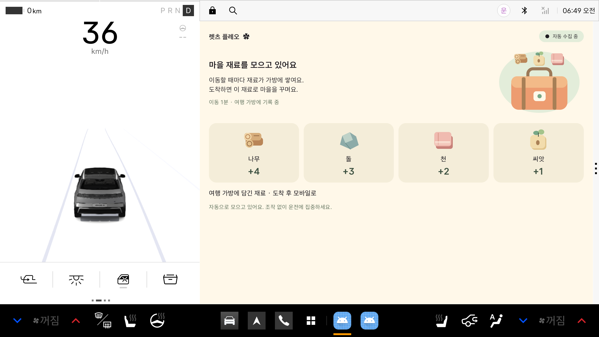
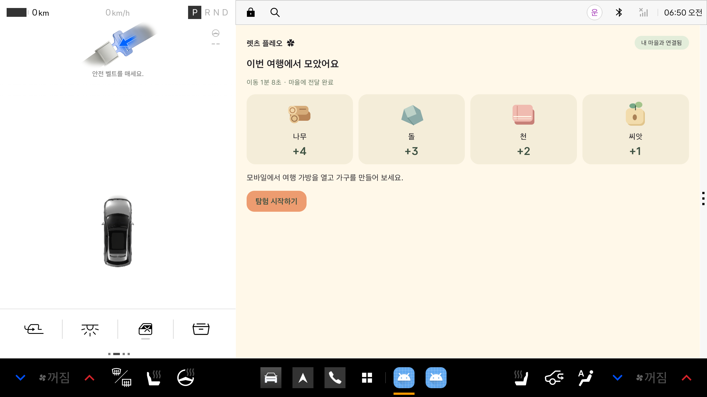
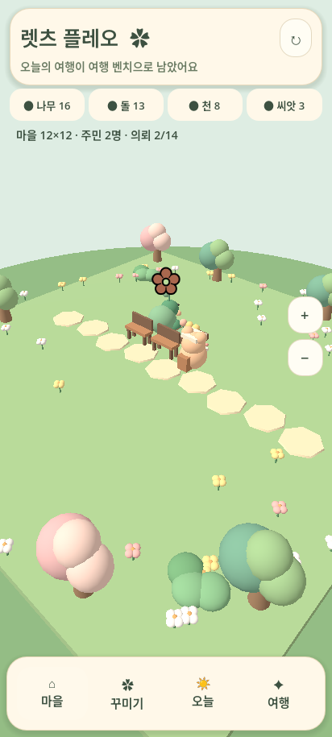
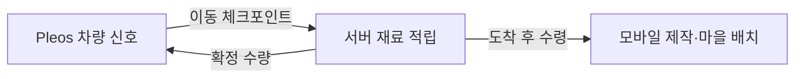

# 렛츠 플레오 · Let's Pleo

**차에서 모은 재료로 휴대전화 속 작은 마을을 꾸미는 게임.**

정차 중 탐험을 시작하면 주행 기록에 따라 나무·돌·천·씨앗이 여행 가방에 쌓입니다. 도착하면 같은 재료를 모바일에서 받아 가구를 만들고 마을에 놓습니다.

[APK·시연 영상 다운로드](https://github.com/lsh1215/lets-pleo/releases/tag/v0.1.0-demo) · [89초 데모 영상](https://github.com/lsh1215/lets-pleo/releases/download/v0.1.0-demo/lets-pleo-demo.mp4)



## 데모에서 확인할 수 있는 것

- 실제 Pleos 에뮬레이터의 속도·기어 신호 → 재료 수량 증가. 정지하면 누적도 멈춥니다.
- 주행 중 수량은 서버에 적립된 값이며, 도착 전에는 모바일 수령이 잠깁니다.
- P·정지 30초 후 자동 종료 → 동일 보상 수령 → 여행 벤치 제작·배치.
- 모바일 3D 마을, 자체 제작 가구·건물 27종, 주민 3종, 의뢰 14개, 정원·마을 확장.
- 차량과 모바일의 8자리 코드 연결, Room 전송 대기열, 재전송·중복 수령 방지.

| 도착 결과 | 모바일 마을 |
|---|---|
|  |  |

영상은 실제 SDK 입력과 앱 UI를 녹화해 발췌한 것입니다. 게임 시계 가속·재료 주입을 사용하지 않았습니다. 실차 시험은 아닙니다.

## 기술 구성

| 구성 | 기술 | 역할 |
|---|---|---|
| `car/` | Kotlin, Jetpack Compose, Room, Pleos FusedLocation 1.1.3, AAOS Car API | 위치·속도·기어·UX 제한, 주행 수집과 전송 |
| `server/` | Node.js 22, TypeScript, Fastify, SQLite | 계정 연결, 실시간 적립, 보상·제작·배치·진행 |
| `mobile/` | Godot 4.7.2 Standard, GDScript, Compatibility renderer | 3D 마을·가구·주민, 제작·꾸미기 |



새 차량 앱은 유효 이동 15초당 나무 2·돌 1, 30초당 천 1·씨앗 1을 적립합니다. 일일 상한은 나무 12·돌 9·천 6·씨앗 3이며 기존 당일 보상도 합산합니다. 여행 시작일의 한국 날짜를 사용합니다. 속도가 빠르다고 추가 보상을 주지 않습니다. 구형 클라이언트의 5분/15분 보따리 규칙은 호환용으로 유지합니다.

## 실행하기

### 1. 서버

```sh
cd server
npm ci
npm run build
npm test
PORT=4187 LETS_PLEO_DB=./lets-pleo.sqlite npm start
```

Node.js 22가 필요합니다. 서버는 개발 호스트의 `127.0.0.1:4187`에 바인딩합니다. 두 Android 에뮬레이터는 `http://10.0.2.2:4187`로 연결합니다. 외부 계정·유료 API 키는 필요하지 않습니다.

### 2. 차량 앱

JDK 17, Android SDK 35, Pleos Connect 에뮬레이터와 Android `android.car` 라이브러리가 필요합니다. `car/local.properties`에 로컬 SDK 경로를 설정합니다.

```sh
cd car
./gradlew :app:testDebugUnitTest :app:assembleDebug
```

산출물: `car/app/build/outputs/apk/debug/app-debug.apk` (`dev.pleos.letspleo`). 위치 및 차량 속도 권한을 허용하고, 정차 상태에서 모바일 여행 탭의 연결 코드를 입력합니다. 별도 설치용 데모 변형은 `:app:assembleDemo`, 앱 ID는 `dev.pleos.letspleo.demo`입니다.

### 3. 모바일 앱

Godot 4.7.2와 같은 버전의 Android export templates, JDK 17, Android SDK가 필요합니다.

```sh
godot --headless --path mobile --export-debug Android ../lets-pleo-mobile.apk
```

모바일 앱 ID는 `dev.pleos.letspleo.mobile`입니다. 여행 탭에서 코드를 받고 차량에 연결한 뒤, 차량에서 탐험을 시작하세요. 받은 재료로 추천 가구를 제작하고 마을에 배치할 수 있습니다.

## 검증 환경과 범위

- 차량: Pleos Connect AAOS API 34 이미지, 작업 전용 LetsPleoCar, **2560×1440 / 160dpi**, host GPU.
- 모바일 데모: Android API 36, **412×915 / 160dpi**, host GPU. API 34는 이전 빌드에서 별도 확인했습니다.
- 최신 서버 테스트 **18개**, 차량 JVM 테스트 **9개** 및 debug/demo APK 빌드 통과.
- 최신 통합 시연: 유효 이동 **68초**, 중간 정지에서 수량 유지, **4/3/2/1** 도착·수령 일치, 벤치 제작 비용 **4/1/0/0**, 신규 배치물 1개 확인.
- 현재는 **로컬 에뮬레이터용 데모**입니다. 실차·스토어 배포, 새 적립 경로의 장시간 오프라인/복구·날짜 경계 전체 검증은 남았습니다. 기존 51개 제품 기준 전체 완료를 뜻하지 않습니다.
- APK는 로컬 HTTP 개발 서버를 사용하는 debug 서명 빌드입니다. 단독 설치만으로 서버가 생기지 않습니다. 실제 휴대전화·원격 서버 배포에는 서버 주소 및 HTTPS 설정 변경이 필요합니다.

## 문서

- [개발 계획과 성공 기준](docs/lets-pleo-plan.md)
- [디자인 규칙](DESIGN.md)
- [모델·에셋 출처](docs/assets.md)
- [빌드 환경](docs/repository-setup.md)

공모전 심사 환경·형식은 [공식 추가 안내](https://appdevchallenge.auto-hmg.io/notice/c0a1a000-2026-4923-8000-000000000007)를 참고했습니다. 개인정보가 포함된 접수양식과 서명은 공개 저장소·릴리즈에 포함하지 않습니다.
