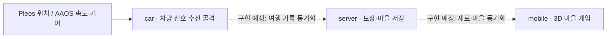

# 렛츠 플레오

**차에서 떠난 여행이 휴대전화 속 작은 마을로 이어지는 게임.**

정차 중 차량에서 탐험을 시작하고, 도착 후 휴대전화에서 여행 재료를 받아 마을을 꾸미는 경험을 만들고 있습니다. 여행가방 안에 사는 ‘길콩이’들과 함께 가구를 만들고, 건물을 배치하고, 새로운 주민을 맞이하는 것이 목표입니다.

현재는 **차량 연동을 확인하는 초기 프로토타입**입니다. 이 저장소에서 빌드할 수 있는 것은 차량 앱 골격이며, 모바일 3D 게임과 보상 서버는 구현 예정입니다.

## 만들고 있는 경험

1. **출발 전:** 정차 상태에서 차량 앱으로 탐험을 시작합니다.
2. **이동 중:** 차량 신호를 바탕으로 여행을 기록하는 흐름을 구현합니다.
3. **도착 후:** 모바일에서 여행 보상을 받고, 재료로 마을을 꾸미는 흐름으로 확장합니다.

차에서는 탐험의 시작과 결과 확인을, 모바일에서는 제작과 마을 꾸미기를 담당하도록 설계했습니다.

## 구성과 구현 상태



| 구성 | 역할 | 현재 상태 |
|---|---|---|
| `car` | 차량 신호 읽기, 탐험 시작·종료, 주행 중 조작 제한 | Compose 화면과 신호 수신 코드, APK 빌드 확인 |
| `server` | 여행 검증, 보상 지급, 계정·마을 데이터 저장 | 구현 예정 |
| `mobile` | 3D 마을, 제작·배치, 주민과 성장 | 구현 예정 |

차량 앱은 `MainActivity`에서 UX 제한을 확인하고, `TripProbeService`에서 위치·속도·기어 신호를 구독하는 구조입니다. 실제 차량 신호 수신과 차량·서버·모바일의 연결은 아직 검증하지 않았습니다.

**현재 기술:** Kotlin · Jetpack Compose · Pleos FusedLocation · AAOS Car API  
**계획 기술:** Godot · TypeScript / Fastify · SQLite

## 실행하기

JDK 17, Android SDK 35, Pleos Connect 에뮬레이터가 필요합니다.

1. Android Studio에서 `car/`를 열고 Android SDK 경로를 설정합니다.
2. 아래 명령으로 차량 앱을 빌드합니다.
3. Android Studio에서 `app`을 Pleos 에뮬레이터에 실행합니다. 현재 화면은 차량 연동 확인용이며 게임 화면은 제공하지 않습니다.

```sh
cd car
./gradlew :app:assembleDebug
```

APK: `car/app/build/outputs/apk/debug/app-debug.apk` — 저장소 루트 기준 경로입니다.

## 더 알아보기

- [게임 기획·아키텍처·개발 계획](docs/lets-pleo-plan.md)
- [빌드 환경과 저장소 설정](docs/repository-setup.md)
- [차량 앱 개발 기록](docs/development-notes-20261115.md)
